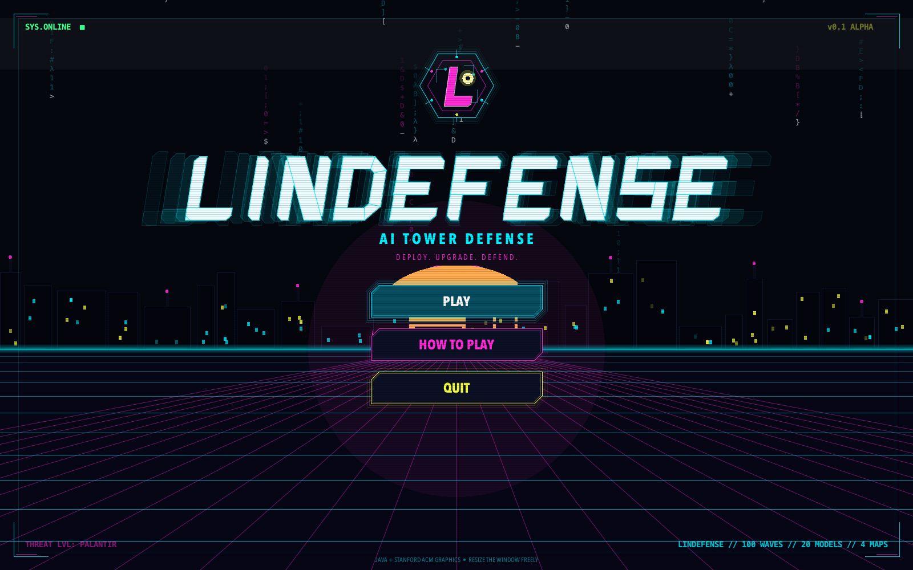

# Lindefense - AI Tower Defense



Lindefense is a complete, playable tower-defense game written in Java with the Stanford ACM Graphics
library (`GCanvas`, `GCompound`, `GOval`, `GRect`, `GPolygon`, `GLine`, `GLabel`). You defend a track
with 20 real AI models and companies (3 heroes + 17 towers) against 100 waves of computer-science
enemies - data structures, sorting algorithms and five corporate MOAB-class bosses - ending with the
BAD-class final boss **Palantir** on Wave 100.

The window opens large (about 92% of your screen) and is freely resizable: the whole game scales to
fit whatever size you drag it to.

All tuning numbers (tower stats, upgrades, abilities, enemy stats, boss phases, every wave) are in
data classes and documented in [DESIGN.md](DESIGN.md), which is generated from those classes.

## 1. Setup

Requirements:

- JDK 11 or newer on your `PATH` (`javac` / `java`). Developed and tested with JDK 24 on macOS.
- `lib/acm.jar` - the Stanford/ACM Java Task Force graphics library (included in this repository).

If `lib/acm.jar` is ever missing, download the canonical JTF build and place it at `lib/acm.jar`:

```
mkdir -p lib
curl -L -o lib/acm.jar https://cs.stanford.edu/people/eroberts/jtf/acm.jar
unzip -l lib/acm.jar | grep GraphicsProgram      # should list acm/program/GraphicsProgram.class
```

(Any CS106A course distribution of `acm.jar` also works.) No other dependencies, build tools or
network access are needed.

## 2. Build and run

macOS / Linux:

```
./build.sh      # compiles src/ into build/ with -Xlint
./run.sh        # builds if needed, then launches the game
./test.sh       # builds and runs the headless verification suite
```

Windows (Command Prompt / PowerShell):

```
build.bat
run.bat
test.bat
```

Manual equivalents:

```
javac -d build -cp lib/acm.jar @<(find src -name '*.java')      # or list the files
java  -cp build:lib/acm.jar lindefense.Main                      # use ; instead of : on Windows
java  -cp build:lib/acm.jar lindefense.test.HeadlessTests        # headless checks
java  -cp build:lib/acm.jar lindefense.tools.DesignDocGenerator  # regenerate DESIGN.md
java  -cp build:lib/acm.jar lindefense.tools.AutoPlayer [maxWave] [mapIndex]   # balance probe (bot plays the maps)
#   optional: -Dbot.maxTowers=N -Dbot.random=true to handicap the bot (tower cap / random placement)
```

## 3. Controls

| Input | Action |
|---|---|
| Shop card, then left-click on the map | Buy and place a tower (ghost shows range; green = valid, red = invalid with the reason) |
| `B` / **ALL** button | Toggle the shop between one faction tab and a grid of all 20 towers grouped by faction (unaffordable towers are dimmed with a red price; hovering shows the shortfall). Clicking a faction tab leaves ALL mode |
| Left-click a placed tower | Select it: stats, upgrade button, targeting, ability, sell |
| Left-click an enemy | Inspect it (HP, speed, mechanic, modifiers) |
| Right-click / `Esc` | Cancel placement or deselect |
| `Space` / **Start Wave** button | Start the next wave (never starts automatically unless **Auto** is on) |
| `1` `2` `3` / buttons | Game speed 1x / 2x / 3x |
| `P` / `||` button | Pause (resume with `P` or the play button) |
| `U` | Upgrade the selected tower |
| `S` | Sell the selected tower (70% refund) |
| `A` | Fire the selected tower's ability |
| `T` | Cycle targeting priority (First / Last / Strongest / Weakest / Closest) |
| **Auto** button | Auto-start the next wave 8 s after the current one is cleared |
| **Menu** button | Back to the main menu |

## 4. Gameplay

- You start with **$650** and **100 lives**. Enemies that reach an exit remove lives based on their
  strength (1 for a Primitive Variable, up to 100 for a ZOMG or Palantir). At 0 lives you lose.
- Destroying enemies pays cash; every wave pays a bonus ($100 + wave) and Perplexity towers add
  research income. Rewards taper in the late game (see DESIGN.md) so economy decisions matter.
- Every tower has **four upgrades** (five states) named after its real model lineup - upgrading
  Claude buys "Claude Sonnet 5.5", then "Claude Fable 5.1", "Claude Opus 5.5" and finally the
  expensive superclass "Claude Mythos", which changes how the tower plays. (This deviates from the
  original spec's "exactly 3 upgrades" rule at the user's request.) Each tower also has a unique
  **active ability** with a cooldown (gold ring = ready, bar = cooling down), configurable
  **targeting**, and sells for 70% of everything spent on it.
- **Modifiers**: *Camo* enemies cannot be targeted without detection (Perplexity, Bellarmine
  Student + AI, Brad Lindemann T3, or their auras). *Regrow* enemies heal 1 HP every 2 s.
  *Fortified* enemies have double HP (Qwen strips it).
- **Bosses** appear on waves 40 (MOAB), 60 (BFB), 80 (ZOMG), 90 (DDT) and 100 (BAD) with large
  health bars, armour, and children released on destruction.
- **Palantir** (Wave 100) has three phases (armour 60% / 35% / 10%, faster each phase, Lockheed
  escorts in phase 3) and **Predictive Surveillance**: every 30/20/14 s it analyses your
  highest-investment towers for 3 s (red reticles and analysis lines), then disrupts them for 8 s
  (-50% speed, -30% range, abilities locked). Counter it with Perplexity (Encrypted Index), Copilot
  (Workspace Firewall), Bellarmine Student + AI (AGI Thesis) or Brad (Supreme Commander) auras,
  Brad's Command Override, or by spreading your investment. Destroying Palantir wins the campaign.

## 5. Towers

| Faction | Towers | Role |
|---|---|---|
| Heroes | Bellarmine Student, Bellarmine Student + AI, Brad Lindemann | Physical damage; autonomous targeting + detection; commander support and heavy artillery (most expensive unit by far) |
| Primary | Gemini, Claude, GPT | Chain lightning vs groups; piercing + slowing crowd control; adaptive all-rounder |
| Military | DeepSeek, Copilot | Railgun vs complex enemies/bosses; attack-speed aura (double for Military) and Surveillance firewall |
| Magic | DALL-E, Sora, Suno | Splash + Sprite summons; time-slowing pulses; sonic pulses vs dense groups |
| Support | Grok, Perplexity | Disruption of enemy mechanics; camo detection, marks and income |
| Experimental Titans | Qwen, Llama, Mistral, Cohere, GLM, Kimi, MiniMax | Layer/Fortified stripping; kinetic knockback; wind vs fast enemies; armour-breaking single target; gravity crowd control; scaling damage vs non-Fortified; bouncing/cloning orbs |

Full stats, upgrade paths and abilities: [DESIGN.md section 2](DESIGN.md#2-towers).

## 6. Enemies

| Enemy | HP | Speed | Mechanic |
|---|---|---|---|
| Primitive Variable | 1 | 1.0x | Basic |
| Static Array | 2 | 1.4x | Releases 1 Primitive Variable |
| Dynamic Array | 3 | 1.8x | Releases 1 Static Array |
| Singly Linked List | 4 | 3.2x | Very fast |
| Doubly Linked List | 5 | 3.5x | Accelerates when damaged |
| Bubble Sort | 3 | 0.9x | Swaps position with the enemy ahead |
| Selection Sort | 4 | 1.0x | Jumps to the front of its group |
| Insertion Sort | 4 | 1.5x | Leapfrogs the enemy ahead |
| Shell Sort | 5 | 2.0x | Gap jumps (140 / 70 / 35 / 18 px) |
| Merge Sort | 6 | 1.1x | Splits into two Merge Runs (2 HP) |
| Quick Sort | 7 | 1.8x | Splits into two Quick Partitions (3 HP) |
| Heap Sort | 8 | 1.2x | Physical-immune; shields enemies behind it |
| Counting Sort | 1 + 4 nodes | 1.3x | Releases 4 Primitive Variables |
| Radix Sort | 8 | 1.5x | Armour changes every two layers |
| Bucket Sort | 6 | 1.4x | Stores nearby weaker enemies, releases them on death |
| TimSort | 10 | 1.6x | Fast; splits into Merge Sort + Insertion Sort |

Bosses: Bellarmine College Prep (MOAB), SW Resource Consultant (BFB), 3Com (ZOMG), Lockheed Martin
(DDT: camo, fast, Physical-immune), Palantir (BAD). Details and precise rules:
[DESIGN.md sections 3-4](DESIGN.md#3-enemies).

## 7. Maps

| Map | Difficulty | Unique mechanics |
|---|---|---|
| The Silicon Circuit | Beginner | Two lanes; Capacitor Pads charge Support/Hero towers for cash and speed; Trace Short-Circuits zap one lane and boost towers along it |
| The Legacy Monolith | Intermediate | Serpentine server rack; chassis block line of sight; Thermal Overload Venting every 10 waves on a random floor |
| The Hallucination Canyon | Advanced | Two crossing routes; Attention Drift teleports 25% of enemies at the hub; Noise Storms halve range unless a Logic Specialist (DeepSeek/Copilot) is near |
| The Singularity Core | Expert | Four portals spiralling into a vortex; Gravitational Pull speeds enemies up near the core; Event Horizon Collapse on wave 50 resets cooldowns and scatters enemies |

The map select screen lays out every map registered in `MapCatalog` (4 per row), so additional maps appear automatically; `DESIGN.md` section 5 is generated from the same registry.

## 8. Project layout

```
src/lindefense/
  Main.java                 entry point
  sim/      Game (state, economy, fixed-step loop), Vec, Rng
  map/      GameMap, Path (waypoints), Obstacle, the four maps, MapCatalog
  enemy/    EnemyType (data table), Enemy, Boss (phases + Predictive Surveillance), EnemyManager, modifiers/status
  tower/    TowerType, TowerCatalog (data table), TowerDef/TowerStats/UpgradeDef/AbilityDef, Tower,
            TowerManager, AbilityManager, Shop, Targeting
  combat/   Combat (targeting, attacks, damage formula), Projectile, HitSpec, DamageType, VisualEvent
  wave/     WaveData (all 100 waves), WaveDef, SpawnGroup, WaveManager
  ui/       LindefenseProgram (ACM GraphicsProgram), ScaledLayer (resize scaling), GameScreen, WorldView,
            HudPanel, SidePanel, TowerSprite, MenuScreen, MapSelectScreen, UIButton, Ui, DemoDriver
  ui/sprites/  enemy and boss character sprites (EnemySprite, SpriteFactory, Animated)
  test/     HeadlessTests - verification suite run without a window
  tools/    DesignDocGenerator (DESIGN.md), AutoPlayer (balance bot)
lib/acm.jar
build.sh / run.sh / test.sh   (and .bat equivalents)
```

The simulation (`sim`, `map`, `enemy`, `tower`, `combat`, `wave`) has no dependency on ACM or AWT
and runs headless; the `ui` package renders it.

## 9. Testing

`./test.sh` runs `lindefense.test.HeadlessTests`, which exercises the real game logic: purchase /
upgrade / sell and the 70% refund, exactly four upgrades (five states) for all 20 towers, rewards without
duplicate-kill exploits, lives on leaks, every targeting priority, camo vs detection, Fortified and
Regrow, every splitter's children, boss children, all 100 wave compositions (including Palantir on
Wave 100), Palantir's phases and Predictive Surveillance, ability cooldowns, traversal of every
route on all four maps, map mechanics, win and loss conditions, and a late-wave stress run.

`java -Dlindefense.demo=<dir> -cp build:lib/acm.jar lindefense.Main` runs a scripted UI walkthrough
(menu -> map select -> game -> window resizes -> Palantir) that writes PNG snapshots and verifies
click-to-place after resizing.
